# LeRobot SO-101 模仿学习抓取与语言条件策略（仿真复现）

> **个人项目 · 2026.01 – 2026.03** · 作者：陈彦希
>
> **一句话定位**：在一台 2 核无 GPU 的 Windows 机器上，从零实现「SO-101 风格
> 5-DOF 机械臂仿真 → 脚本专家演示 → LeRobot v3 风格数据集 → ACT 模仿学习 →
> 语言条件策略 → 闭环评测 / GIF」的完整可复现管线；并**如实报告**仿真里的
> 实测成功率、推理延迟与失败模式。
>
> ⚠️ **本项目没有真机、没有 ROS2、没有遥操作采集**。演示数据由仿真中的脚本
> 专家生成；"抓取"由几何规则判定。这是**算法与数据管线验证**，不是真机结果。
> 真机落地方案见 [`docs/real_robot.md`](docs/real_robot.md)。

---

## 1. 效果速览（全部为实测值）

<!-- METRICS_TABLE_START -->
> 全部为仿真闭环 rollout 实测值（每个 split 20 个独立 scene seed），无真机实验。
> 机器：2 物理核 / 4 逻辑线程 CPU，无 GPU；详细协议见
> [`docs/evaluation.md`](docs/evaluation.md)，原始数据见 `reports/`。

| 指标 | ACT（单积木） | 语言条件策略（双积木 + 中文指令） |
| --- | ---: | ---: |
| 已见物体成功率（seen, 20 trials） | **50.0%**（10/20） | — |
| 未见物体成功率（unseen, 20 trials） | **10.0%**（2/20） | — |
| 语言指令完整任务成功率（20 trials） | — | **15.0%**（3/20） |
| 抓取 grounding（抓对指令指定积木） | — | 4/4（发生抓取的 trial 中 100%） |
| 放错积木率 | — | 10.0% |
| 单次循环时间（仿真） | 7.41 s（seen）/ 7.93 s（unseen） | 7.87 s |
| 单次循环时间（wall-clock，含渲染） | 0.96 s（seen）/ 0.83 s（unseen） | 1.27 s |
| 单 chunk 推理延迟 mean / p95（CPU） | 15.3 / 38.8 ms（seen） | 20.9 / 51.4 ms |
| 参数量 / checkpoint | 0.68 M / **2.76 MB** | 0.41 M / **1.66 MB** |
| 训练耗时（CPU） | **~65 min**（3 段续训，见 docs） | **18.0 min** |
| demo GIF 体积 | 0.32 MB | 0.19 MB |

**诚实结论**：行为克隆在本机 CPU 预算内把已见物体抓取从 0 提到 50%，但未见
物体只有 10%；语言条件策略验证了「中文指令 → 不同动作」的链路，闭环收益
未超过同场景无语言 ACT 基线（25%），原因与数据/算力限制见
[`docs/evaluation.md`](docs/evaluation.md) §3.2。

<!-- METRICS_TABLE_END -->

演示 GIF（真实 rollout，非手工动画）：

| ACT 抓取-放置 | 语言条件策略 |
| --- | --- |
|  |  |

> 左：front / wrist 双相机拼接；右：中文指令「把 X 色积木放进盒子里」。

---

## 2. 架构

```mermaid
flowchart LR
    subgraph SIM["① 仿真与数据采集（真机时替换为遥操作）"]
        A[SO-101 风格 5-DOF + 夹爪<br/>解析 FK/IK] --> B[桌面场景 + 域随机化<br/>颜色/尺寸/位姿/相机误差/遮挡/滑移]
        B --> C[脚本专家 Cartesian 状态机<br/>60 步 = 8.0 s]
        C --> D[双相机 96×96<br/>front + wrist]
    end
    subgraph DATA["② 数据格式（LeRobot v3 子集）"]
        D --> E[LeRobotDatasetWriter<br/>meta/info.json · episodes.jsonl · stats.json]
        E --> F[data/chunk-000/*.parquet<br/>6 维 state / 6 维 action]
        E --> G[videos/chunk-000/*/*.mp4<br/>H.264 双相机]
    end
    subgraph TRAIN["③ 训练（CPU）"]
        F --> H[build_cache<br/>64×64 + action chunk 20 + 归一化]
        G --> H
        H --> I[ACT 策略<br/>CNN + Transformer + CVAE]
        H --> J[语言条件策略<br/>字符级可训练词表 + Transformer]
        I --> K[checkpoints/act.pt<br/>含归一化统计]
        J --> L[checkpoints/lang_cond.pt<br/>含中文词表]
    end
    subgraph EVAL["④ 闭环评测"]
        K --> M[20 seen + 20 unseen 独立 rollout]
        L --> N[20 双积木中文指令 rollout]
        M --> O[成功率 / 失败模式 / 延迟 / 循环时间]
        N --> O
        O --> P[reports/eval_*.json/.md + GIF]
    end
```



数据流细节、模块职责与设计取舍见 [`docs/architecture.md`](docs/architecture.md)。

---

## 3. 快速开始

环境：Windows / Linux，Python 3.10–3.12，**CPU 即可**（本项目全程 2 核无 GPU）。
建议用 `uv` 建虚拟环境：

```bash
uv venv --python 3.12 .venv
# Windows: .venv\Scripts\activate    Linux/macOS: source .venv/bin/activate

# CPU 版 PyTorch（约 2 分钟）
uv pip install --index-url https://download.pytorch.org/whl/cpu torch
uv pip install -r requirements.txt
```

### 3.1 生成演示数据（约 2–3 分钟 / 80 条）

```bash
# 80 条单积木抓取-放置（ACT 训练用）
python scripts/generate_dataset.py --out data/demos_act --episodes 80

# 80 条双积木 + 中文指令（语言条件策略训练用）
python scripts/generate_dataset.py --out data/demos_lang --episodes 80 --mode lang
```

> 仓库已提交生成好的 `data/demos_act`（2.5 MB）与 `data/demos_lang`（2.8 MB），
> 因此克隆后可直接训练。重新生成会覆盖，脚本要求显式 `--overwrite`。

### 3.2 训练

```bash
# CI smoke（3 条 episode、2 epoch，约 1–2 分钟）
python scripts/train_act.py --smoke

# 正式 ACT 训练（CPU；受吞吐限制分三段续训，`--max-minutes` 到点自动保存最优 checkpoint）
python scripts/train_act.py --dataset data/demos_act --epochs 12 --max-minutes 20 --lr 2.5e-4

# 语言条件策略
python scripts/train_lang_cond.py --dataset data/demos_lang --epochs 12 --max-minutes 18
```

训练日志：`reports/train_act_*.json`（每个 epoch 的 loss / val L1 / rollout 成功率 /
吞吐）+ `reports/train_act_*.png` 曲线；checkpoint 在 `checkpoints/`（已 gitignore）。

### 3.3 评测

```bash
# ACT：已见 20 + 未见 20（真实闭环，seed 与训练不相交）
python scripts/eval_policy.py --policy act --checkpoint checkpoints/act.pt \
    --replan 3 --ensemble-decay 0.01

# 语言条件策略：20 个双积木中文指令场景
python scripts/eval_policy.py --policy lang --checkpoint checkpoints/lang_cond.pt \
    --replan 3 --ensemble-decay 0.01 --lang-trials 20
```

输出 `reports/eval_act_*.json/.md`、`reports/eval_lang_*.json/.md`（含失败案例
描述与失败画面拼图）。

### 3.4 录制 demo GIF（真实 rollout）

```bash
python scripts/record_demo.py --act-checkpoint checkpoints/act.pt \
                              --lang-checkpoint checkpoints/lang_cond.pt
```

### 3.5 测试

```bash
pytest -q          # 全部 CPU 测试，约 1–2 分钟
```

---

## 4. 数据集格式（LeRobot v3 子集）

目录布局、parquet 列、视频编码、统计量说明见
[`docs/dataset_format.md`](docs/dataset_format.md)。核心约定：

```
data/demos_act/
├── meta/{info.json, episodes.jsonl, episodes_meta.jsonl, tasks.jsonl, stats.json}
├── data/chunk-000/episode_XXXXXX.parquet
└── videos/chunk-000/observation.images.{front,wrist}/episode_XXXXXX.mp4
```

- 80 episodes × 60 步 = 4800 帧；`fps = 7.5`（60 步 / 8.0 s 单次循环）。
- `observation.state` / `action` 均为 6 维：5 个臂关节 + 夹爪。
- 双相机 96×96×3 H.264（`libx264`, `yuv420p`, CRF 18）。
- `meta/episodes_meta.jsonl` 是本仓库扩展：记录每条 episode 的颜色/尺寸/位姿/
  相机外参抖动/遮挡/滑移概率，便于按场景切片做失败复盘。
- **与官方 LeRobot v3 的 6 处差异**（详见 docs）：① 不依赖 `lerobot` 包；
  ② 每 episode 一个 parquet（官方 v3 多 episode 打包成 `file_*.parquet`）；
  ③ `episodes.jsonl` 缺 `videos/*/chunk_index` 等字段；④ `stats.json` 为简化
  形状；⑤ 数据集划分写在 `splits` 而非官方工具约定；⑥ 生成器是仿真脚本专家
  而非真机遥操作，且多了 `generation` 字段声明这一点。

---

## 5. 模型与训练细节

### 5.1 ACT（`src/so101_policy/act.py`）

- **视觉 backbone**：两个相机共享的小 CNN（4 层 stride-2 卷积，64×64 → 4×4
  特征图，每相机 16 个 token），不依赖预训练 ResNet18 权重（离线可复现）。
- **Transformer**：encoder 2 层 + decoder 2 层（`d_model=128`, 4 heads）；
  CVAE latent 32 维（训练时从动作序列推断，推理时 `z=0`）。
- **动作分块**：chunk = 20，预测未来 20 步动作；评测时每 3 步重规划，并对
  重叠预测做 **时序集成（temporal ensembling, decay=0.01）**——该技巧在
  验证集上把成功率从 4/10 提到 7/10（见 `docs/evaluation.md`）。
- **参数 / 大小**：0.68 M 参数，checkpoint 约 2.76 MB（CPU 训练友好）。
- **训练配置**：batch 32、AdamW、短余弦 LR（2.5e-4→0.01×）、L1 + 10×KL、
  `num_workers=0`、AMP 关闭、`torch.set_num_threads(4)`；受 CPU 吞吐限制，
  训练分 3 段续训（共 ~65 min），每段日志都在 `reports/train_act.json` 里。

### 5.2 语言条件策略（`src/so101_policy/lang_cond.py`）

- 轻量「SmolVLA-style」：**不是** SmolVLA（没有下载 450M 预训练权重），
  而是视觉 token + **字符级可训练 token embedding**（词表从中文指令语料构建）
  + state token + Transformer encoder → action chunk。
- 支持「把红色积木放进盒子里」类中文指令；checkpoint 保存词表，未知字符映射
  到 `<unk>`。
- 与 ACT 相同的动作空间、归一化、分块执行方式，便于公平比较推理延迟。

### 5.3 训练 / 推理对齐

1. 归一化统计只在**训练 split** 上计算并写入 checkpoint，评测用同一统计反归一化；
2. 数据集 96×96 → 训练/评测统一 resize 64×64（同一代码路径）；
3. 控制频率一致：7.5 Hz（仿真 60 步 / 8 s，ROS2 节点定时器也是 7.5 Hz）；
4. 动作 chunk 执行方式在训练期验证与最终评测中保持一致（每 5 步重规划）。

---

## 6. 评测方法与结果

评测协议、seen/unseen 分布定义、指标定义、完整结果与失败案例见
[`docs/evaluation.md`](docs/evaluation.md)。简要：

- **已见物体**：训练同分布（红/蓝/绿、尺寸/位置在训练范围），20 个独立 scene seed；
- **未见物体**：黄色/紫色（训练中从未出现）、更大尺寸、更远位置，20 个独立 seed；
- **成功定义**：积木被抓取并落入盒子内部；
- **指标**：成功率、失败模式（抓空 / 滑移 / 放偏 / 超时）、单次循环时间
  （仿真秒 + wall-clock）、单 chunk 推理延迟（CPU batch=1）。

<!-- EVAL_RESULTS_START -->
| split / 策略 | trials | 成功 | 成功率 | chunk 延迟 mean/p95 | 仿真循环 | 失败模式 |
| --- | ---: | ---: | ---: | ---: | ---: | --- |
| ACT seen | 20 | 10 | **50.0%** | 15.3 / 38.8 ms | 7.41 s | grasp_miss:9, slip:1 |
| ACT unseen | 20 | 2 | **10.0%** | 12.4 / 24.5 ms | 7.93 s | grasp_miss:18 |
| Lang-cond（双积木中文指令） | 20 | 3 | **15.0%** | 20.9 / 51.4 ms | 7.87 s | grasp_miss:16, slip:1 |

- 语言指令完整任务成功率 15%，抓取 grounding 4/4，放错积木率 10%。
- **同场景对照**：无语言输入的 ACT 在同一批 20 个 lang scene 上成功 5/20（25%），
  说明本实验的语言条件策略没有带来闭环成功率收益（训练预算 18 min vs 65 min）。
- 失败以「抓空」为主（seen 的 10 个失败里 9 个），诊断显示末端 xy 误差仍大于
  1.2 cm 抓取容差；unseen 的颜色/尺寸/位置都超出训练分布，仅 2/20 成功。
<!-- EVAL_RESULTS_END -->

---

## 7. 失败案例（真实遇到）

完整复盘见 [`docs/failure_cases.md`](docs/failure_cases.md)。摘要：

1. **夹爪滑移概率公式写反**：`slip += 0.02 * max(0, 0.25 - opening)` 在夹爪
   完全闭合时反而最大，导致脚本专家 40 个种子里失败 8 个；修正为
   `0.05 * max(0, opening)` 后 40/40 成功。
2. **统计量全局计数 bug**：state/action 共用一个 count，`meta/stats.json` 里
   出现 `mean < min`；由测试发现，改为每特征独立计数。
3. **CI smoke 训练空验证集崩溃**：3 条 episode 配 `val_episodes=8` 导致
   zero-size 数组；对切分做 clamp 并让 smoke 用独立 cache 路径。
4. **渲染性能**：初版 33 ms/观测且每步渲染两次，80 条数据要 ~9 分钟；
   缓存静态背景 + 背面剔除 + 复用 step 观测后降到 ~12 ms，生成 137 s。
5. **训练吞吐低于预期**：2 核机器上同机其他进程占用约 2.6/4 逻辑核，
   实际 epoch 90–310 s（原计划 ~50 s），单段长余弦计划在预算内无法收敛；
   最终改为 3 段「续训 + 短余弦」共 ~65 min，并如实记录
   `steps_per_second` 与学习率曲线（`reports/train_act.json`、`.png`）。
6. **推理超参影响很大**：`replan=1` 在验证集 0/8，`replan=3 + 时序集成`
   把验证成功率从 4/10 提到 7/10；最终评测采用后者，但训练/推理的
   chunk 执行方式必须一致。
7. **语言条件不能用哈希词袋**：固定哈希无法学习颜色→物体的对应关系，改为
   字符级可训练 embedding，并加测试保证「不同指令产生不同动作预测」。
8. **评测失败案例**：ACT 在未见物体上的典型失败是「抓空」，语言策略主要
   失败模式同为抓空；详见 `reports/eval_*.md` 与失败画面拼图。

---

## 8. 限制与下一步

**限制（诚实说明）**

1. 全程仿真：**没有真机、没有遥操作**，抓取由几何规则判定，不是接触物理引擎；
2. 2 核 CPU 训练预算有限（~20–55 分钟），模型仅 0.68 M 参数、64×64 输入，
   成功率受算力约束明显；训练吞吐数据已写入报告；
3. 演示专家接近“完美 IK”，没有真机的手眼标定误差、接触抖动与运动模糊；
4. `seen` 与 `unseen` 各 20 trials，统计置信区间较宽（约 ±10%）；
5. 语言条件策略为轻量实现，不是 SmolVLA；它验证的是「中文指令 + 视觉选择
   目标」这一条件化链路，不是大规模预训练的语义泛化。

**下一步**

1. 换 8 核以上 CPU 或单卡 GPU，把训练预算提到数小时，复跑正式 200 epoch；
2. 增加数据量（200–400 条）与真机风格增广（运动模糊、曝光、相机安装角变化）；
3. 动作空间改为「当前位姿 + delta」以提升 cm 级精度；
4. 真机按 [`docs/real_robot.md`](docs/real_robot.md) 采集 80–100 条遥操作数据，
   跑同一套 writer/train/eval 脚本，给出真实 sim2real 对比；
5. 语言条件策略换成 Hugging Face 上预训练的 SmolVLA 做对照（需要 GPU）。

---

## 9. 真实 SO-101 落地计划

硬件 BOM（约 2000–3000 元）、遥操作采集 80–100 条流程、标定与相机安装误差、
sim2real 注意事项、代码改动清单见 [`docs/real_robot.md`](docs/real_robot.md)。

ROS2 部署骨架：`ros2_ws/src/so101_policy_node/`（ament_python 包，订阅双相机 +
joint states，加载 checkpoint，发布 action；**本机没有 ROS2，未运行**，仅通过
`py_compile` 与结构测试，节点内注释说明数据流与话题）。

---

## 10. 目录

```
lerobot-so101-act/
├── src/
│   ├── so101_sim/          # FK/IK、场景、渲染、抓取环境、脚本专家
│   ├── so101_dataset/      # LeRobot v3 子集 writer/reader/stats/cache
│   └── so101_policy/       # ACT、语言条件策略、归一化、推理、rollout、训练工具
├── scripts/                # 生成数据 / 训练 / 评测 / 录 GIF
├── tests/                  # 50 个 CPU 测试
├── docs/                   # architecture / dataset_format / evaluation / failure_cases / real_robot
├── data/demos_act, demos_lang   # 已生成的演示数据集（LeRobot v3 风格）
├── demos/                  # 真实 rollout GIF（提交）
├── reports/                # 训练日志、评测报告、数据集统计、曲线图
├── ros2_ws/                # ROS2 推理节点骨架（未运行）
└── .github/workflows/ci.yml
```

---

## 11. 版本与声明

- 版本：v0.1.0（2026.03）
- 许可证：[MIT](LICENSE) © 2026 陈彦希
- 测试：`pytest -q`（50 个测试：FK/IK、场景、环境、数据集 roundtrip、统计量、
  动作分块、ACT/语言策略 shape、归一化、训练/评测 smoke、ROS2 节点编译）
- 复现实验的随机种子全部固定；数据集生成、训练、评测的 seed 空间互不重叠。
- **声明**：本仓库不包含任何真机遥操作数据或真机实验结果；所有成功率均为
  仿真结果。README 与文档中出现的数字都由本仓库脚本实际运行产生。
