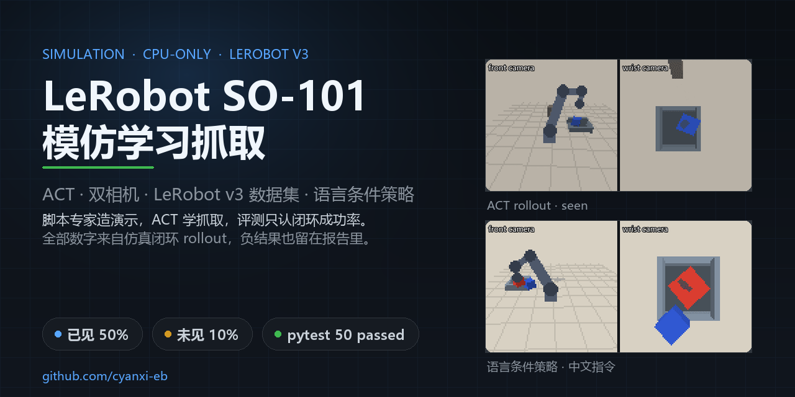
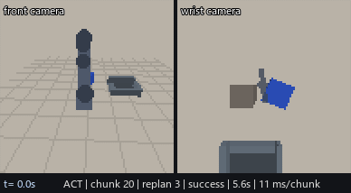
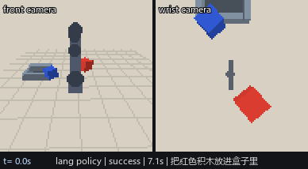

# LeRobot SO-101 模仿学习抓取（仿真）



> **个人项目 · 2026.01 – 2026.03** · 维护：cyanxi-eb
>
> **一句话定位**：把仿真里的 SO-101 抓取演示，走成一条能复现的管线 ——
> 脚本专家采数据 → LeRobot v3 风格数据集 → ACT 模仿学习 → 语言条件策略
> → 闭环评测和 rollout 录像。主干是 CPU 管线；另做了一次 32 GB 单卡重训实验
> （见 §6.1），用同一套脚本验证算力换来的增益。
>
> 边界先说清楚：**没有真机、没有遥操作采集，也没有在 ROS2 上实跑**。演示
> 数据由仿真里的脚本专家生成，"抓取成功"由几何规则判定。这里验证的是算法和
> 数据管线，不是真机性能。真机怎么落地另写了一份
> [`docs/real_robot.md`](docs/real_robot.md)。

---

## 1. 效果速览（全部实测）

下表每一行都是仿真闭环 rollout 的实测值：每个 split 20 个独立 scene seed，
seed 与训练不相交。协议和指标定义见
[`docs/evaluation.md`](docs/evaluation.md)，原始数据在 `reports/`。

<!-- METRICS_TABLE_START -->
| 指标 | ACT（单积木） | 语言条件策略（双积木 + 中文指令） |
| --- | ---: | ---: |
| 已见物体成功率（seen, 20 trials） | **50.0%**（10/20） | — |
| 未见物体成功率（unseen, 20 trials） | **10.0%**（2/20） | — |
| 语言指令完整任务成功率（20 trials） | — | **15.0%**（3/20） |
| 抓取 grounding（抓对指令指定积木） | — | 4/4（发生抓取的 trial 中 100%） |
| 放错积木率 | — | 10.0% |
| 单次循环时间（仿真） | 7.41 s（seen）/ 7.93 s（unseen） | 7.87 s |
| 单次循环时间（wall-clock，含渲染） | 0.96 s（seen）/ 0.83 s（unseen） | 1.27 s |
| 单 chunk 推理延迟 mean / p95（CPU） | 15.3 / 38.8 ms（seen） | 20.9 / 51.4 ms |
| 参数量 / checkpoint | 0.68 M / **2.76 MB** | 0.41 M / **1.66 MB** |
| 训练耗时（CPU） | **~65 min**（3 段续训，见 docs） | **18.0 min** |
| demo GIF / MP4 体积 | 0.32 MB / 25 KB | 0.19 MB / 30 KB |

读表记住三点就够：

- 已见物体 10/20，换成没见过的颜色和更大、更远的积木只剩 2/20。这是真实的
  分布漂移，不是数据采坏了。
- 语言条件策略 3/20，低于同一批场景上无语言输入的 ACT 基线 5/20。这个负结果
  留在报告里，原因见 §7。
- CPU 上单 chunk 十几到二十几毫秒，7.5 Hz 的控制循环跑得动。

<!-- METRICS_TABLE_END -->

> **2026-10 GPU 重训（补充实验）**：在 32 GB 单卡上把数据加到 240 条、
> 输入提到 96×96，加光度/平移增广并做双 checkpoint 集成。同 seed 20 trials
> 下 **seen 55%（11/20）、unseen 25%（5/20）**，同协议重跑的 CPU 基线是
> 40% / 15%；训练从 CPU 的 ~65 min 降到 18 min。协议、消融和失败分析见
> §6.1 和 [`docs/gpu_retrain.md`](docs/gpu_retrain.md)。

演示取自真实 rollout，不是手工动画：

| ACT 抓取-放置 | 语言条件策略 |
| --- | --- |
| <br>GIF / [MP4](demos/01_act_rollout.mp4) | <br>GIF / [MP4](demos/02_lang_cond.mp4) |

> 左：front / wrist 双相机拼接；右：中文指令「把红色积木放进盒子里」。
> GIF 方便预览，MP4 是同一批帧的 H.264 版本（388×214，10 fps）。

---

## 2. 架构

```mermaid
flowchart LR
    subgraph SIM["① 仿真与数据采集（真机时替换为遥操作）"]
        A[SO-101 风格 5-DOF + 夹爪<br/>解析 FK/IK] --> B[桌面场景 + 域随机化<br/>颜色/尺寸/位姿/相机误差/遮挡/滑移]
        B --> C[脚本专家 Cartesian 状态机<br/>60 步 = 8.0 s]
        C --> D[双相机 96×96<br/>front + wrist]
    end
    subgraph DATA["② 数据格式（LeRobot v3 子集）"]
        D --> E[LeRobotDatasetWriter<br/>meta/info.json · episodes.jsonl · stats.json]
        E --> F[data/chunk-000/*.parquet<br/>6 维 state / 6 维 action]
        E --> G[videos/chunk-000/*/*.mp4<br/>H.264 双相机]
    end
    subgraph TRAIN["③ 训练（CPU）"]
        F --> H[build_cache<br/>64×64 + action chunk 20 + 归一化]
        G --> H
        H --> I[ACT 策略<br/>CNN + Transformer + CVAE]
        H --> J[语言条件策略<br/>字符级可训练词表 + Transformer]
        I --> K[checkpoints/act.pt<br/>含归一化统计]
        J --> L[checkpoints/lang_cond.pt<br/>含中文词表]
    end
    subgraph EVAL["④ 闭环评测"]
        K --> M[20 seen + 20 unseen 独立 rollout]
        L --> N[20 双积木中文指令 rollout]
        M --> O[成功率 / 失败模式 / 延迟 / 循环时间]
        N --> O
        O --> P[reports/eval_*.json/.md + GIF]
    end
```

四层，各管一件事：仿真层造演示，数据层把演示写成 LeRobot 目录，策略层负责学，
评测层只认闭环成功率。



模块职责、数据流细节和每个设计取舍的代价见
[`docs/architecture.md`](docs/architecture.md)。

---

## 3. 快速开始

环境：Python 3.10–3.12，CPU 就够。本仓库所有数字都来自无 GPU 的 CPU 环境。
建议用 `uv` 建虚拟环境：

```bash
uv venv --python 3.12 .venv
# Windows: .venv\Scripts\activate    Linux/macOS: source .venv/bin/activate

# CPU 版 PyTorch（约 2 分钟）
uv pip install --index-url https://download.pytorch.org/whl/cpu torch
uv pip install -r requirements.txt
```

### 3.1 生成演示数据（约 2–3 分钟 / 80 条）

```bash
# 80 条单积木抓取-放置（ACT 训练用）
python scripts/generate_dataset.py --out data/demos_act --episodes 80

# 80 条双积木 + 中文指令（语言条件策略训练用）
python scripts/generate_dataset.py --out data/demos_lang --episodes 80 --mode lang
```

> 仓库已经提交生成好的 `data/demos_act`（2.6 MB）和 `data/demos_lang`
> （2.9 MB），克隆下来就能直接训练。重新生成会覆盖，脚本要求显式
> `--overwrite`。

### 3.2 训练

```bash
# CI smoke（3 条 episode、2 epoch，约 1–2 分钟）
python scripts/train_act.py --smoke

# 正式 ACT 训练（CPU；受吞吐限制分三段续训，`--max-minutes` 到点自动保存最优 checkpoint）
python scripts/train_act.py --dataset data/demos_act --epochs 12 --max-minutes 20 --lr 2.5e-4

# 语言条件策略
python scripts/train_lang_cond.py --dataset data/demos_lang --epochs 12 --max-minutes 18
```

训练日志写到 `reports/train_act.json`（每个 epoch 的 loss / val L1 / rollout
成功率 / 吞吐）和 `reports/train_act.png` 曲线；checkpoint 落在
`checkpoints/`（已 gitignore），仓库里不带权重。

### 3.3 评测

```bash
# ACT：已见 20 + 未见 20（真实闭环，seed 与训练不相交）
python scripts/eval_policy.py --policy act --checkpoint checkpoints/act.pt \
    --replan 3 --ensemble-decay 0.01

# 语言条件策略：20 个双积木中文指令场景
python scripts/eval_policy.py --policy lang --checkpoint checkpoints/lang_cond.pt \
    --replan 3 --ensemble-decay 0.01 --lang-trials 20
```

输出 `reports/eval_act_*.json/.md`、`reports/eval_lang_*.json/.md`，带失败案例
描述和失败画面拼图。

### 3.4 录制 demo

```bash
python scripts/record_demo.py --act-checkpoint checkpoints/act.pt \
                              --lang-checkpoint checkpoints/lang_cond.pt
```

生成 `demos/01_act_rollout.gif`、`demos/02_lang_cond.gif` 和
`demos/demos.json`。

### 3.5 测试

```bash
pytest -q          # 全部 CPU 测试，约 1–2 分钟
```

---

## 4. 数据集格式（LeRobot v3 子集）

目录约定对齐 LeRobot v3，但**没有**依赖 `lerobot` 包 —— 官方包的依赖在纯 CPU
环境里太重。parquet 列、视频编码、统计量细节见
[`docs/dataset_format.md`](docs/dataset_format.md)，这里只列日常会用到的部分：

```
data/demos_act/
├── meta/{info.json, episodes.jsonl, episodes_meta.jsonl, tasks.jsonl, stats.json}
├── data/chunk-000/episode_XXXXXX.parquet
└── videos/chunk-000/observation.images.{front,wrist}/episode_XXXXXX.mp4
```

- 80 episodes × 60 步 = 4800 帧；`fps = 7.5`（60 步 / 8.0 s 单次循环）。
- `observation.state` / `action` 都是 6 维：5 个臂关节 + 夹爪。
- 双相机 96×96×3 H.264（`libx264`, `yuv420p`, CRF 18）。
- `meta/episodes_meta.jsonl` 是本仓库的扩展：记录每条 episode 的颜色、尺寸、
  位姿、相机外参抖动、遮挡和滑移概率，方便按场景切片做失败复盘。
- **与官方 LeRobot v3 的 6 处差异**：① 不依赖 `lerobot` 包；② 每 episode 一个
  parquet（官方 v3 是多 episode 打包成 `file_*.parquet`）；③ `episodes.jsonl`
  缺 `videos/*/chunk_index` 等字段；④ `stats.json` 是简化形状；⑤ 数据集划分
  写在 `splits` 里，不走官方工具；⑥ 生成器是仿真脚本专家，不是真机遥操作，
  并且多了 `generation` 字段来说明这一点。

---

## 5. 模型与训练细节

### 5.1 ACT（`src/so101_policy/act.py`）

- **视觉 backbone**：两个相机共享的小 CNN（4 层 stride-2 卷积，64×64 → 4×4
  特征图，每相机 16 个 token），不加载预训练 ResNet18，离线也能复现。
- **Transformer**：encoder 2 层 + decoder 2 层（`d_model=128`, 4 heads）；
  CVAE latent 32 维（训练时从动作序列推断，推理时 `z=0`）。
- **动作分块**：chunk = 20，一次预测未来 20 步；评测每 3 步重规划，并对重叠
  预测做**时序集成（temporal ensembling, decay=0.01）**。这个技巧在验证集上
  把成功率从 4/10 提到 7/10，见 [`docs/evaluation.md`](docs/evaluation.md)。
- **参数 / 大小**：0.68 M 参数，checkpoint 约 2.76 MB，CPU 训练友好。
- **训练配置**：batch 32、AdamW、短余弦 LR（2.5e-4→0.01×）、L1 + 10×KL、
  `num_workers=0`、关 AMP、`torch.set_num_threads(4)`（按机器改）；CPU 吞吐
  只够分 3 段续训（合计 ~65 min），每段日志都在 `reports/train_act.json`。

### 5.2 语言条件策略（`src/so101_policy/lang_cond.py`）

- 轻量「SmolVLA-style」：**不是** SmolVLA（没下载 450M 预训练权重），而是视觉
  token + **字符级可训练 token embedding**（词表从中文指令语料构建）+ state
  token + Transformer encoder → action chunk。
- 支持「把红色积木放进盒子里」这类中文指令；checkpoint 里存词表，未知字符
  映射到 `<unk>`。
- 动作空间、归一化、分块执行方式与 ACT 完全一致，推理延迟可以直接横向比。

### 5.3 训练 / 推理对齐

1. 归一化统计只在**训练 split** 上算，写进 checkpoint；评测用同一份统计反归一化。
2. 数据集 96×96 → 训练和评测都 resize 到 64×64，走同一段代码。
3. 控制频率一致：7.5 Hz（仿真 60 步 / 8 s，ROS2 节点定时器也是 7.5 Hz）。
4. 动作分块执行：训练期验证和最终评测都用 `replan_interval=3`（chunk=20，
   每 3 步重规划一次），避免「训练用整段、推理逐步」的分布错位。

---

## 6. 评测方法与结果

评测协议、seen / unseen 的分布定义、指标定义和完整结果在
[`docs/evaluation.md`](docs/evaluation.md)。要点：

- **已见物体**：训练同分布（红/蓝/绿，尺寸和位置都在训练范围），20 个独立
  scene seed；
- **未见物体**：黄色/紫色（训练中从未出现）、更大尺寸、更远位置，20 个种子；
- **成功定义**：积木被抓取并落入盒子内部；
- **指标**：成功率、失败模式（抓空 / 滑移 / 放偏 / 超时）、单次循环时间
  （仿真秒 + wall-clock）、单 chunk 推理延迟（CPU batch=1）。

<!-- EVAL_RESULTS_START -->
| split / 策略 | trials | 成功 | 成功率 | chunk 延迟 mean/p95 | 仿真循环 | 失败模式 |
| --- | ---: | ---: | ---: | ---: | ---: | --- |
| ACT seen | 20 | 10 | **50.0%** | 15.3 / 38.8 ms | 7.41 s | grasp_miss:9, slip:1 |
| ACT unseen | 20 | 2 | **10.0%** | 12.4 / 24.5 ms | 7.93 s | grasp_miss:18 |
| Lang-cond（双积木中文指令） | 20 | 3 | **15.0%** | 20.9 / 51.4 ms | 7.87 s | grasp_miss:16, slip:1 |

- 语言指令完整任务成功率 15%，抓取 grounding 4/4，放错积木率 10%。
- **同场景对照**：无语言输入的 ACT 在同一批 20 个 lang scene 上成功 5/20
  （25%）。也就是说，语言条件策略没有带来闭环成功率收益（训练预算 18 min
  vs 65 min）。
- 失败以「抓空」为主（seen 的 10 个失败里 9 个），诊断显示末端 xy 误差仍大于
  1.2 cm 的抓取容差；unseen 的颜色、尺寸、位置都超出训练分布，只有 2/20 成功。
<!-- EVAL_RESULTS_END -->

---

### 6.1 GPU 重训实验（32 GB 单卡）

2026-10 补的一次补充实验：把演示从 80 条加到 240 条（脚本专家、96×96 双相机），
在单卡 32 GB 上训练两种 ACT，再试双 checkpoint 集成。同协议（同 seed、replan=5、
无时序集成）、20 trials/split 的结果：

| 策略 | seen | unseen | chunk 延迟（seen） |
| --- | ---: | ---: | ---: |
| CPU 基线（80 条，0.68 M，同协议重跑） | 8/20（40%） | 3/20（15%） | 4.1 ms |
| GPU 大模型（240 条，2.09 M，150 epoch） | 10/20（50%） | 1/20（5%） | 4.2 ms |
| GPU 增广（240 条，0.68 M + 光度/平移增广） | 8/20（40%） | **7/20（35%）** | 4.2 ms |
| **双 checkpoint 集成**（大模型 + 增广，等权平均） | **11/20（55%）** | 5/20（25%） | 6.5 ms |

- **增广解决的是分布漂移**：unseen 从 15% 提到 35%；大模型只对已见分布有用
  （50%），几乎不迁移到没见过的颜色（5%）；集成把两边合起来，seen 55%、
  unseen 25%，两个 split 都不低于 CPU 基线。
- 训练 150 epoch 用 10.2 min、100 epoch 用 7.3 min（GPU batch=128，约 25 steps/s），
  相比 CPU 版 65 min 是数量级差别；模型和报告在 `checkpoints/act_240_*.pt`、
  `reports/gpu/`。
- 50 trials/split 的对照里，CPU 基线是 19/50（38%）/ 4/50（8%）；集成只跑了
  20 trials 这套，原因是本地 CPU 复评太慢，没把 50 trials 的集成结果算进主表。
- 失败仍然以 `grasp_miss`（抓空）为主，说明瓶颈是视觉定位精度，不是抓取后放偏；
  下一步的动作空间 delta 化、运动模糊/曝光增广和语言策略 GPU 重训都写在
  [`docs/gpu_retrain.md`](docs/gpu_retrain.md) §5。

---

## 7. 失败案例（真实遇到）

完整复盘在 [`docs/failure_cases.md`](docs/failure_cases.md)，这里挑几个有代表性
的。

1. **夹爪滑移公式写反了**：`slip += 0.02 * max(0, 0.25 - opening)` 在夹爪完全
   闭合时反而给出最大滑移，脚本专家 40 个种子里挂了 8 个。改成
   `0.05 * max(0, opening)` 后 40/40 成功。
2. **统计量共用一个 count**：state 和 action 两次 `update` 只记一个计数器，
   `meta/stats.json` 里算出 `mean < min`。测试逮到，改成每特征独立计数。
3. **CI smoke 崩在空验证集**：3 条 episode 配 `val_episodes=8`，给 `np.min`
   切出 0 帧。切分做 clamp，smoke 改用独立 cache 路径。
4. **渲染太慢**：初版 33 ms/观测，而且每步渲染两次，80 条数据要 ~9 分钟。
   缓存静态背景 + 背面剔除 + 复用 step 观测后降到 ~12 ms，总生成 137 s。
5. **训练吞吐低于预期**：计划每个 epoch ~50 s，实测首个 134 s，后面到
   270–300 s（机器上同时还有别的任务在跑）。长余弦计划在预算内收不了敛，最后
   改成 3 段「续训 + 短余弦」，合计 ~65 min；`steps_per_second` 和学习率曲线
   都留在 `reports/train_act.json`。
6. **推理超参比训练更影响结果**：验证集上 `replan=1` 是 0/8，
   `replan=3 + 时序集成` 是 7/10。最终评测用后者，训练期验证也用同一套 chunk
   执行方式。
7. **语言特征不能上哈希词袋**：固定哈希学不会「红色对应哪个物体」，只能死记
   颜色位置。换成字符级可训练 embedding，并加测试保证不同指令给出不同动作预测。
8. **评测里的失败模式**：ACT 在未见物体上主要是抓空；语言策略同样是抓空为主。
   完整清单和失败画面在 `reports/eval_*.md` 和 `reports/eval_*_failures.png`。

---

## 8. 限制与下一步

**限制**

1. 全程仿真：没有真机、没有遥操作，抓取由几何规则判定，不是接触物理引擎；
2. CPU 主干预算有限（单段 ~20 min，合计 ~65 min），模型只有 0.68 M 参数、64×64
   输入；2026-10 用 32 GB 单卡补了 240 条 + 96×96 + 增广/集成的重训
   （seen 55% / unseen 25%），但真机结论仍然没有；
3. 脚本专家接近「完美 IK」，没有真机的手眼标定误差、接触抖动和运动模糊；
4. 每个 split 20 trials，置信区间大约 ±10%，50% 和 40% 的差别别当显著；
5. 语言条件策略是轻量实现，不是 SmolVLA；它验证的是「中文指令 + 视觉选目标」
   这条条件化链路，不是大规模预训练带来的语义泛化。

**下一步**

1. 单卡 GPU 已经跑通（240 条、96×96、增广 + 集成）；下一步把演示加到 400–600
   条，补运动模糊、曝光、相机安装角变化，并把 50 trials 的集成结果补齐；
2. 动作空间改成「当前位姿 + delta」，冲 cm 级精度；
3. 按 [`docs/real_robot.md`](docs/real_robot.md) 采 80–100 条遥操作数据，跑同一套
   writer / train / eval 脚本，给出真实的 sim2real 对比；
4. 语言条件策略换成 Hugging Face 上预训练的 SmolVLA / VLM 做对照（需要 GPU），
   阶段和验收口径见 [`ROADMAP.md`](ROADMAP.md)；
5. 集成推理延迟是单模型的 2×，真机前要蒸馏成单模型或换更大 batch 的部署方式。

---

## 9. 真实 SO-101 落地计划

硬件 BOM（约 2000–3000 元）、遥操作采集 80–100 条的流程、标定与相机安装误差、
sim2real 注意事项、代码改动清单都在
[`docs/real_robot.md`](docs/real_robot.md)。

ROS2 部署骨架在 `ros2_ws/src/so101_policy_node/`：ament_python 包，订阅双相机
和 joint states，加载 checkpoint，发布 action。**没有在 ROS2 环境里跑过**，
只过了 `py_compile` 和结构测试；数据流和话题名写在节点注释里。

---

## 10. 目录

```
lerobot-so101-act/
├── src/
│   ├── so101_sim/          # FK/IK、场景、渲染、抓取环境、脚本专家
│   ├── so101_dataset/      # LeRobot v3 子集 writer/reader/stats/cache
│   └── so101_policy/       # ACT、语言条件策略、归一化、推理、rollout、训练工具
├── scripts/                # 生成数据 / 训练 / 评测 / 录 GIF（含 eval_ensemble.py）
├── tests/                  # 50 个 CPU 测试
├── docs/                   # architecture / dataset_format / evaluation / failure_cases / real_robot / gpu_retrain
├── data/demos_act, demos_lang   # 已生成的演示数据集（LeRobot v3 风格）
├── demos/                  # 真实 rollout GIF + MP4
├── assets/                 # 封面图
├── checkpoints/            # CPU 基线 + GPU 重训（act_240_gpu / act_240_aug）
├── reports/                # 训练日志、评测报告、数据集统计、曲线图（gpu/ 是重训实验）
├── ros2_ws/                # ROS2 推理节点骨架（未运行）
└── .github/workflows/ci.yml
```

- 版本：v0.1.0（2026.03）
- 许可证：[MIT](LICENSE) © 2026 cyanxi-eb
- 测试：`pytest -q`，50 个用例（FK/IK、场景、环境、数据集 roundtrip、统计量、
  动作分块、ACT / 语言策略 shape、归一化、训练 / 评测 smoke、ROS2 节点编译）
- 复现实验的随机种子全部固定；数据集生成、训练、评测的 seed 空间互不重叠。
- 仓库不含真机遥操作数据或真机实验结果，所有成功率都是仿真结果。README 和文档
  里的数字都由仓库脚本实际跑出来。
