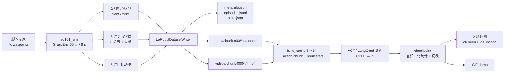

# 架构说明

> 个人项目 · 2026.01–2026.03。这篇讲仓库怎么分层、数据怎么流、每个取舍付了什么
> 代价。**前提**：没有真实 SO-101 硬件，也没有遥操作数据。演示数据由仿真里的
> 脚本专家（Cartesian 状态机 + 解析 IK）配合域随机化生成，属于算法和数据管线
> 验证，不是真机结果。真机方案见 `docs/real_robot.md`。

## 1. 分层

```
┌────────────────────────────────────────────────────────────────────┐
│                        scripts/（入口层，不含算法）                  │
│  generate_dataset.py  train_act.py  train_lang_cond.py             │
│  eval_policy.py       record_demo.py                               │
└───────────────┬───────────────────────────┬────────────────────────┘
                │                           │
┌───────────────▼──────────────┐  ┌─────────▼────────────────────────┐
│ src/so101_sim/（仿真环境）     │  │ src/so101_dataset/（数据层）      │
│ kinematics  FK/IK（解析）      │  │ writer  写 parquet + mp4          │
│ scene       场景 + 域随机化    │  │ reader  读回 + 全局帧索引         │
│ render      96×96 双相机渲染   │  │ stats   meta/stats.json           │
│ env         抓取物理 + 60 步   │  │ cache   64×64 训练缓存 + 动作分块 │
│ expert      脚本专家 + 失败判定 │  │ layout  LeRobot v3 路径约定       │
└───────────────┬──────────────┘  └─────────┬────────────────────────┘
                │                           │
┌───────────────▼───────────────────────────▼────────────────────────┐
│ src/so101_policy/（策略层）                                         │
│ act.py        ACT 策略（CNN + Transformer + CVAE + action chunk）   │
│ lang_cond.py  语言条件策略（字符级 token 词表 + 视觉 + Transformer） │
│ normalization.py  动作 / 状态归一化（写入 checkpoint）              │
│ inference.py  checkpoint 自描述加载 + 观测预处理                    │
│ rollout.py    闭环 rollout + 延迟 / 周期 / 失败模式统计             │
│ training.py   批次构建、验证 L1、曲线、报告                          │
└────────────────────────────────────────────────────────────────────┘
```

`src` 布局加上 `pyproject.toml` 里的 `pythonpath` 配置，让 `pytest` 和脚本不用
安装就能跑；同时也支持 `pip install -e .`。

## 2. 端到端数据流



## 3. 关键设计取舍

| 决策 | 选择 | 原因 / 代价 |
| --- | --- | --- |
| 仿真 vs 真机 | 自写运动学仿真（无 ROS2 / Gazebo / 物理引擎） | CPU 上可复现、不需要 GPU；代价是接触和摩擦只是简化规则，不是物理引擎 |
| 机械臂模型 | 5 DOF（base yaw + 3 pitch + tool roll）+ 夹爪 | 与 SO-101 的「5 臂关节 + 1 夹爪」状态维度一致；工具始终朝下，解析 IK 精确可测 |
| 相机 | 两个 96×96 合成视图（front 固定 + 安装误差；wrist 随夹爪） | 96×96 在 CPU 上训得动；双视角提供遮挡和深度线索 |
| 专家 | Cartesian waypoint 状态机 + 解析 IK | 保证演示质量（>98% 成功），失败样例丢弃重采 |
| 动作空间 | 绝对关节目标位置（6 维） | 与 LeRobot 的常见约定一致，推理侧对齐简单（同一份归一化统计） |
| 训练分辨率 | 数据集存 96×96，训练 / 推理统一 resize 到 64×64 | 训练速度约 2×；同一段 resize 代码保证训练推理一致 |
| 策略 | 小型 ACT（~0.68 M 参数，chunk=20，CVAE） | CPU 上约 50 分钟可训练；不是官方 LeRobot 实现 |
| 语言条件 | 字符级可训练词表 + 视觉 token + Transformer | 不用下载 SmolVLA 权重；支持中文指令「把红色积木放进盒子里」 |
| 评测 | 真实闭环 rollout（20 seen + 20 unseen），失败模式分类 | 只报实测值，不用占位数 |

## 4. 训练与推理一致性

1. **归一化统计**：`meta/stats.json` 用全量数据记录；训练缓存的归一化统计只用
   训练集 episode 计算，并写进 checkpoint；评测时用 checkpoint 里的统计推理
   （`Normalizer`），避免训练 / 推理不一致。
2. **图像尺寸**：数据集视频 96×96；缓存构建和评测预处理都走同一段
   `resize_frames` / `F.interpolate` 到 64×64。
3. **控制频率**：环境固定 60 步 × 8 s = 7.5 Hz，与数据集 `fps` 一致；推理节点
   也用 7.5 Hz 定时器。
4. **动作分块执行**：训练期验证与最终评测都用 `replan_interval=3`（chunk=20，
   每 3 步重规划一次），避免「训练用整段、推理逐步」的分布错位。

## 5. 模块职责速查

| 模块 | 关键类 / 函数 | 测试 |
| --- | --- | --- |
| `so101_sim.kinematics` | `fk`, `ik`, `gripper_fingers`, `qpos` | `tests/test_kinematics.py` |
| `so101_sim.scene` | `Scene`, `Block`, `Box`, `CameraSetup` | `tests/test_scene.py` |
| `so101_sim.render` | `Renderer`, `Camera` | 间接由 env / demo 覆盖 |
| `so101_sim.env` | `GraspEnv`, `EnvConfig` | `tests/test_env.py` |
| `so101_sim.expert` | `plan_expert_actions`, `rollout_expert` | `tests/test_env.py` |
| `so101_dataset.writer` | `LeRobotDatasetWriter` | `tests/test_dataset.py` |
| `so101_dataset.reader` | `LeRobotDataset` | `tests/test_dataset.py` |
| `so101_dataset.cache` | `build_cache`, `build_action_chunks` | `tests/test_dataset.py` |
| `so101_policy.act` | `ACTPolicy`, `act_loss` | `tests/test_policy.py` |
| `so101_policy.lang_cond` | `LangConditionedPolicy`, `CharTokenizer` | `tests/test_policy.py` |
| `so101_policy.rollout` | `run_rollout`, `summarise_rollouts` | `tests/test_training_eval.py` |
| `ros2_ws/.../policy_node.py` | `SO101PolicyNode` | `tests/test_ros2.py`（仅 py_compile） |
