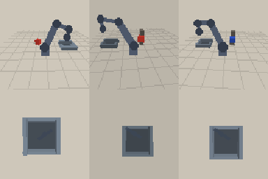

# Evaluation - act policy

- Generated: 2026-10-20T20:30:26
- Checkpoint: `checkpoints\act.pt` (2.76 MB, 0.68M parameters)
- Control: 7.5 Hz, max 60 steps (8.0 s), replan every 3 steps
- Success: the instructed block ends inside the box after release

| split | trials | success | success rate | chunk latency (mean / p95) | sim cycle | wall cycle | failure modes |
| --- | ---: | ---: | ---: | ---: | ---: | ---: | --- |
| seen | 20 | 10 | 50.0% | 15.276 / 38.796 ms | 7.413 s | 0.965 s | slip: 1, grasp_miss: 9 |
| unseen | 20 | 2 | 10.0% | 12.425 / 24.546 ms | 7.927 s | 0.834 s | grasp_miss: 18 |

## Failure cases

- seed 3000, failure=slip, target=red (half-size 0.0178 m), occluder=False, steps=60
- seed 3001, failure=grasp_miss, target=red (half-size 0.0212 m), occluder=True, steps=60
- seed 3002, failure=grasp_miss, target=blue (half-size 0.0199 m), occluder=True, steps=60
- seed 3004, failure=grasp_miss, target=red (half-size 0.0217 m), occluder=True, steps=60
- seed 3005, failure=grasp_miss, target=blue (half-size 0.0206 m), occluder=True, steps=60

## Notes

- Simulator-only evaluation. There is no real SO-101 hardware in this project;
  see `docs/real_robot.md` for the real-robot protocol.
- Scene seeds are disjoint from training and from the seeds used for
  training-time checkpoint selection.
- `unseen` changes colour (yellow/purple never seen in training), block size
  and workspace position, so the gap to `seen` is a real distribution-shift gap.
- Latency is measured per action chunk on this CPU (batch size 1), including
  image resize / normalisation but excluding simulator rendering.
