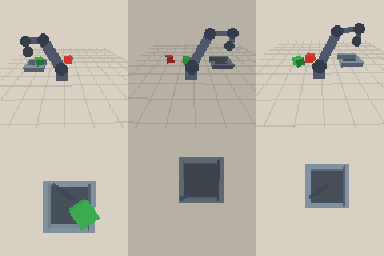

# Evaluation - lang policy

- Generated: 2026-10-20T20:27:46
- Checkpoint: `checkpoints\lang_cond.pt` (1.66 MB, 0.41M parameters)
- Control: 7.5 Hz, max 60 steps (8.0 s), replan every 3 steps
- Success: the instructed block ends inside the box after release

| split | trials | success | success rate | chunk latency (mean / p95) | sim cycle | wall cycle | failure modes |
| --- | ---: | ---: | ---: | ---: | ---: | ---: | --- |
| lang | 20 | 3 | 15.0% | 20.93 / 51.355 ms | 7.867 s | 1.274 s | grasp_miss: 16, slip: 1 |

- Instruction accuracy (full task): 15.0%
- Wrong object placed rate: 10.0%
- Grasp grounding (grasped the instructed block when a grasp happened): 4/4 trials = 100.0%

## Failure cases

- seed 3200, failure=grasp_miss, target=red (half-size 0.0203 m), occluder=False, steps=60, a distractor block ended up in the box
- seed 3202, failure=grasp_miss, target=green (half-size 0.0176 m), occluder=False, steps=60
- seed 3203, failure=grasp_miss, target=red (half-size 0.0186 m), occluder=False, steps=60
- seed 3204, failure=grasp_miss, target=blue (half-size 0.0213 m), occluder=False, steps=60
- seed 3205, failure=grasp_miss, target=green (half-size 0.0194 m), occluder=False, steps=60

## Notes

- Simulator-only evaluation. There is no real SO-101 hardware in this project;
  see `docs/real_robot.md` for the real-robot protocol.
- Scene seeds are disjoint from training and from the seeds used for
  training-time checkpoint selection.
- `unseen` changes colour (yellow/purple never seen in training), block size
  and workspace position, so the gap to `seen` is a real distribution-shift gap.
- Latency is measured per action chunk on this CPU (batch size 1), including
  image resize / normalisation but excluding simulator rendering.
