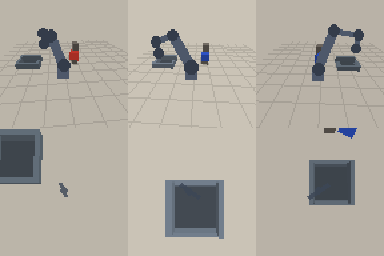

# Evaluation - act policy

- Checkpoint: `checkpoints/act.pt` (2.76 MB, 0.68M parameters)
- Control: 7.5 Hz, max 60 steps (8.0 s), replan every 5 steps
- Success: the instructed block ends inside the box after release

| split | trials | success | success rate | chunk latency (mean / p95) | sim cycle | wall cycle | failure modes |
| --- | ---: | ---: | ---: | ---: | ---: | ---: | --- |
| seen | 50 | 19 | 38.0% | 7.668 / 16.293 ms | 7.64 s | 0.517 s | timeout: 3, grasp_miss: 24, misplace: 4 |
| unseen | 50 | 4 | 8.0% | 7.108 / 9.965 ms | 7.963 s | 0.482 s | grasp_miss: 29, timeout: 16, misplace: 1 |

## Failure cases

- seed 3001, failure=timeout, target=red (half-size 0.0212 m), occluder=True, steps=60
- seed 3002, failure=grasp_miss, target=blue (half-size 0.0199 m), occluder=True, steps=60
- seed 3003, failure=grasp_miss, target=blue (half-size 0.0194 m), occluder=True, steps=60
- seed 3005, failure=grasp_miss, target=blue (half-size 0.0206 m), occluder=True, steps=60
- seed 3006, failure=grasp_miss, target=green (half-size 0.0206 m), occluder=False, steps=60

## Notes

- Simulator-only evaluation. There is no real SO-101 hardware in this project;
  see `docs/real_robot.md` for the real-robot protocol.
- Scene seeds are disjoint from training and from the seeds used for
  training-time checkpoint selection.
- `unseen` changes colour (yellow/purple never seen in training), block size
  and workspace position, so the gap to `seen` is a real distribution-shift gap.
- Latency is measured per action chunk on this CPU (batch size 1), including
  image resize / normalisation but excluding simulator rendering.
