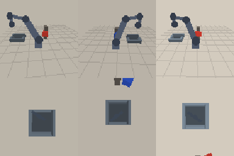

# Evaluation - act_ensemble policy

- Checkpoint: `checkpoints/act_240_gpu.pt + checkpoints/act_240_aug.pt` (11.16 MB, 2.77M parameters)
- Control: 7.5 Hz, max 60 steps (8.0 s), replan every 5 steps
- Success: the instructed block ends inside the box after release

| split | trials | success | success rate | chunk latency (mean / p95) | sim cycle | wall cycle | failure modes |
| --- | ---: | ---: | ---: | ---: | ---: | ---: | --- |
| seen | 20 | 11 | 55.0% | 6.526 / 8.643 ms | 7.42 s | 0.245 s | grasp_miss: 9 |
| unseen | 20 | 5 | 25.0% | 3.405 / 3.577 ms | 7.78 s | 0.181 s | grasp_miss: 15 |

## Failure cases

- seed 3001, failure=grasp_miss, target=red (half-size 0.0212 m), occluder=True, steps=60
- seed 3003, failure=grasp_miss, target=blue (half-size 0.0194 m), occluder=True, steps=60
- seed 3004, failure=grasp_miss, target=red (half-size 0.0217 m), occluder=True, steps=60
- seed 3006, failure=grasp_miss, target=green (half-size 0.0206 m), occluder=False, steps=60
- seed 3011, failure=grasp_miss, target=green (half-size 0.021 m), occluder=False, steps=60

## Notes

- Simulator-only evaluation. There is no real SO-101 hardware in this project;
  see `docs/real_robot.md` for the real-robot protocol.
- Scene seeds are disjoint from training and from the seeds used for
  training-time checkpoint selection.
- `unseen` changes colour (yellow/purple never seen in training), block size
  and workspace position, so the gap to `seen` is a real distribution-shift gap.
- Latency is measured per action chunk on this CPU (batch size 1), including
  image resize / normalisation but excluding simulator rendering.
